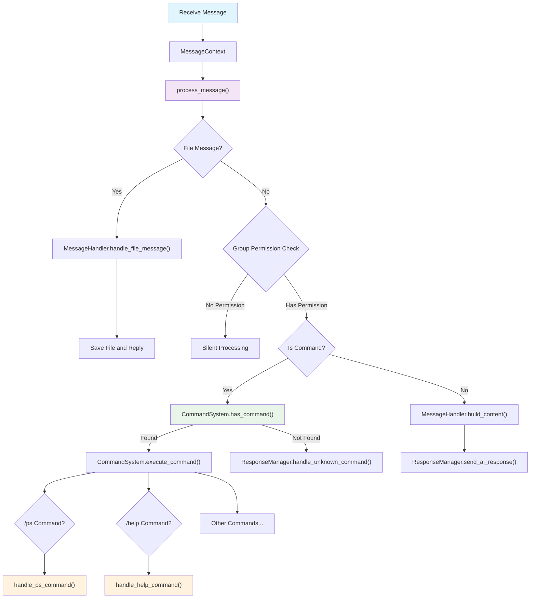
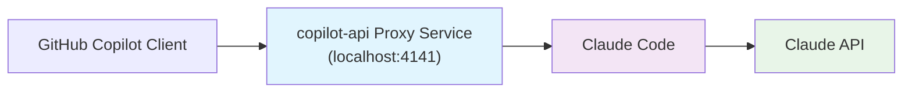

# 🤖 AI Utility Scripts Collection
[](https://opensource.org/licenses/MIT)
[](https://github.com)
[](https://github.com)

[🇨🇳 Chinese](./README_CN.md) | [🇺🇸 English](./README.md)

A comprehensive collection of practical AI-related scripts designed to simplify AI development workflows and automate common tasks.

## 🤖 WXn8n WeChat Bot

### 🚀 Features Overview

WXn8n is an intelligent bot that connects WeChat with N8N workflow platform, supporting:

- 🔗 **N8N Integration** - Seamless connection with N8N workflow platform
- 💬 **Smart Conversations** - AI-powered intelligent replies for text messages
- 📁 **File Processing** - Automatic handling of images, documents, and other file types
- 👥 **Group Management** - Group chat permission control and user management
- ⚡ **Command System** - Rich built-in command functionality (/help, /ps, etc.)
- 🔄 **Real-time Monitoring** - Real-time monitoring of specified users and groups
- 🛡️ **Security Authentication** - Webhook authentication and permission control support

### 🖥️ System Architecture



### 💡 Key Features

#### 🔍 Intelligent Message Processing

- Automatic message type recognition (text, images, files, etc.)
- Support for both group and private chat scenarios
- Smart permission management and user whitelist

#### 📦 N8N Workflow Integration

- **Webhook Triggers**: Seamless integration with N8N via webhooks
- **File Upload**: Support for sending files to N8N for processing
- **Response Handling**: Automatic processing of N8N results and files

#### 🔧 Flexible Configuration Management

- Environment variable configuration support
- Support for test and production environment switching
- Configurable monitoring user and group lists
- Custom timeout and authentication settings

### 🚀 Quick Start

#### 1. Environment Setup

```bash
# Navigate to project directory
cd AICode/wxn8n

# Install dependencies (using uv package manager)
uv sync
```

#### 2. Configuration Setup

```bash
# Copy configuration template
cp config.env.template config.env

# Edit configuration file
# Configure N8N Webhook URL, monitoring user list, etc.
```

#### 3. Run the Bot

```bash
# Activate virtual environment and run
uv run python main.py
```

### ⚙️ Configuration Details

#### Main Configuration Parameters

```bash
# Basic Configuration
SAVE_PATH=                    # File save path
LOG_LEVEL=INFO               # Log level
LISTEN_INTERVAL=1            # Listening interval

# N8N Integration Configuration
WEBHOOK_TEST_URL=            # Test environment Webhook URL
WEBHOOK_PROD_URL=            # Production environment Webhook URL
AUTH_HEADER_KEY=             # Authentication header key
AUTH_HEADER_VALUE=           # Authentication header value

# Monitoring Configuration
LISTEN_USERS=                # Monitoring user list (comma-separated)
LISTEN_GROUPS=               # Monitoring group list (comma-separated)
GROUP_PLUS_USERS=            # Group privileged user list

# Timeout Settings
REQUEST_TIMEOUT=300          # Request timeout
IMG_DOWNLOAD_TIMEOUT=30      # Image download timeout
```

### 📋 System Requirements

- **Python**: 3.12+
- **Dependencies**: wxauto>=39.1.15
- **System**: Windows (WeChat PC version)
- **N8N**: Configured N8N workflow instance

## 🔧 Claude Code Automated Deployment Tool

### 🚀 Features Overview

This is a toolset for automating the deployment of Claude Code and Claude Code Proxy, with support for:

- ✅ **Auto Dependency Installation** - Detects and installs uv, npm, and Claude Code
- 🔄 **Proxy Service Management** - Automatically installs and configures Claude Code Proxy
- 🚀 **One-Click Start** - Configures environment variables and starts the services
- ⚡ **Port Conflict Handling** - Intelligently detects and resolves port occupation issues
- 🔧 **Configuration Management** - Automatically configures the .env file and environment variables
- 🌐 **Cross-Platform Support** - Supports Windows, macOS, and Linux

### 🖥️ System Support

| System | Script File | Description |
|---|---|---|
| 🐧 **Linux/macOS** | `Claude_code_proxy.sh` | Bash script for Unix-like systems |
| 🪟 **Windows** | `Claude_code_proxy.ps1` | PowerShell script for Windows |

## 🔌 Copilot-API Proxy Service

### 🚀 Features Overview

copilot-api is a proxy service that forwards GitHub Copilot API calls to Claude Code, supporting:

- 🔄 **API Proxy Forwarding** - Seamlessly forwards GitHub Copilot API calls to Claude Code
- 🔑 **GitHub Authentication** - Supports GitHub device authorization flow
- 🎯 **Model Mapping** - Automatically maps GitHub Copilot models to corresponding Claude models
- ⚡ **Local Deployment** - Runs proxy service locally for privacy protection
- 🛠️ **Simple Configuration** - One-click installation and configuration for quick setup
- 🌐 **High Compatibility** - Fully compatible with GitHub Copilot API interface

### 💡 How It Works



### 🛠️ Installation & Configuration

#### 1. Install Dependencies

Ensure Node.js is installed on your system, then install the required tools:

```bash
# Install copilot-api
npm install -g copilot-api

# Install Claude Code
npm install -g @anthropic-ai/claude-code
```

#### 2. Start Proxy Service

Open the first terminal and start the proxy service:

```bash
copilot-api start
```

The system will prompt for GitHub authorization. Follow the instructions to visit the page and enter the device code to complete authorization.

#### 3. Configure Claude Code

Add configuration to `~/.claude/settings.json`:

```json
{
  "env": {
    "ANTHROPIC_BASE_URL": "http://localhost:4141",
    "ANTHROPIC_AUTH_TOKEN": "dummy",
    "ANTHROPIC_MODEL": "claude-sonnet-4",
    "ANTHROPIC_SMALL_FAST_MODEL": "claude-3.7-sonnet",
    "DISABLE_NON_ESSENTIAL_MODEL_CALLS": "1",
    "CLAUDE_CODE_DISABLE_NONESSENTIAL_TRAFFIC": "1"
  }
}
```

#### 4. Start Claude Code

In the second terminal, execute:

```bash
claude
```

### 📋 System Requirements

- **Node.js**: 16.0+
- **GitHub Account**: Requires GitHub Copilot access permissions
- **Network Connection**: Stable internet connection for authentication

## 🚀 Quick Start

### 1. Clone the Project

```bash
git clone https://github.com/sylearn/AICode.git
cd AICode/Claude_Code
```

### 2. Run the Script

#### For Linux/macOS

```bash
# Grant execution permission to the script
chmod +x Claude_code_proxy.sh

# Run the script
./Claude_code_proxy.sh
```

#### For Windows

```powershell
# Run PowerShell as Administrator
Set-ExecutionPolicy -ExecutionPolicy RemoteSigned -Scope CurrentUser

# Run the script
.\Claude_code_proxy.ps1
```

### 3. Follow the Prompts to Complete Configuration

The script will automatically detect your environment and guide you through the configuration process.

## 💡 Features

### 🔍 Automatic Environment Detection

- Checks if Node.js and npm are installed
- Checks if the Python package manager uv is installed
- Checks if Claude Code is already installed
- Checks if Git is available

### 📦 Automatic Dependency Installation

- **uv Installation**: Automatically installs the Python package manager from the official source
- **Claude Code Installation**: Installs Claude Code globally via npm
- **Proxy Service Installation**: Automatically clones and configures Claude Code Proxy

### 🔧 Smart Configuration Management

- Automatically generates and updates the `.env` configuration file
- Intelligently detects the local IP address
- Automatically configures proxy server parameters
- Supports custom model and API configurations

### ⚡ Port Conflict Handling

- Automatically detects port usage status
- Intelligently identifies and terminates conflicting processes
- Supports interactive user choices for handling conflicts

## 📋 System Requirements

### Basic Requirements

- **Operating System**: Windows 10+, macOS 10.14+, Linux (Ubuntu 18.04+)
- **Network**: A stable internet connection
- **Permissions**: Administrator privileges (for installing dependencies)

### Software Dependencies

| Software | Version Requirement | Auto-Install | Notes |
|---|---|---|---|
| Node.js | 16.0+ | ❌ | Requires manual installation |
| npm | 8.0+ | ✅ | Installed with Node.js |
| Git | 2.0+ | ❌ | Requires manual installation |
| uv | Latest | ✅ | Script will install automatically |
| Claude Code | Latest | ✅ | Script will install automatically |

## 🛠️ Detailed Usage Instructions

### First Time Use

1.  **Prepare Your Environment**
    -   Ensure Node.js and Git are installed
    -   Have your OpenAI API Key ready
    -   Have your API Base URL ready

2.  **Run the Script**
    -   Download and run the script for your operating system
    -   The script will auto-detect the environment and install any missing dependencies

3.  **Configure Parameters**
    -   The script will prompt you to enter API configuration details
    -   Alternatively, you can directly modify the configuration variables at the top of the script

### Subsequent Use

If initialization is complete, simply run the script to start the services:

```bash
# Linux/macOS
./Claude_code_proxy.sh

# Windows
.\Claude_code_proxy.ps1
```

### Stopping the Services

Press `Ctrl+C` to stop the Claude Code client, and the proxy service will stop automatically.

## ⚙️ Configuration Details

### Main Configuration Parameters

#### Basic Configuration

```bash
# Script Configuration Area (at the top of the script file)
CLAUDE_COMMAND="claude"                    # Claude Code command name
CLAUDE_DIR="$HOME/.claude"                 # Claude Code configuration directory
PROXY_PORT=8082                           # Proxy service port
```

#### API Configuration

```bash
# API-related configuration
OPENAI_API_KEY="your-api-key-here"        # Your OpenAI API Key
OPENAI_BASE_URL="https://api.openai.com/v1" # API Base URL
BIG_MODEL="claude-sonnet-4"               # Large model name
SMALL_MODEL="gpt-4o-mini"                 # Small model name
```

#### Proxy Configuration

```bash
# Proxy service configuration
HOST="0.0.0.0"                           # Service listening address
MAX_TOKENS_LIMIT=32000                    # Max token limit（< 32000）
REQUEST_TIMEOUT=90                        # Request timeout
MAX_RETRIES=3                            # Max retries
```

### Environment Variables

The script will automatically set the following environment variables:

- `CLAUDE_CODE_MAX_OUTPUT_TOKENS`: Max output tokens
- `ANTHROPIC_BASE_URL`: Proxy service address
- `ANTHROPIC_AUTH_TOKEN`: Proxy authentication token

## 🔧 Troubleshooting

### Common Issues

#### 1. Permission Issues

**Issue**: Permission denied error during dependency installation

**Solution**:
```bash
# Linux/macOS
sudo ./Claude_code_proxy.sh

# Windows (Run PowerShell as Administrator)
Set-ExecutionPolicy -ExecutionPolicy RemoteSigned -Scope CurrentUser
```

#### 2. API Error
**Issue**: API Error (401 Invalid API key)
```log
[L] API Error (401 {"detail":"Invalid API key. Please provide a valid Anthropic API key."}) Retrying in 1 second
...
2025-07-14 16:03:56,450 - WARNING - Invalid API key provided by client
```

**Solution**:
```bash
# Check your .env file
cat ~/.claude/proxy/claude-code-proxy/.env
```
Comment out `ANTHROPIC_API_KEY="your-expected-anthropic-api-key"`
or manually navigate to the `~/.claude/proxy/claude-code-proxy` directory and comment out the `ANTHROPIC_API_KEY` line in the `.env` file.


### Debug Mode

To enable debugging, you can change the log level in the script:

```bash
LOG_LEVEL="DEBUG"  # Change the log level to DEBUG
```

### Manual Cleanup

If you need to perform a complete reinstallation:

```bash
# Clean up Claude Code Proxy
rm -rf ~/.claude/proxy

# Reinstall Claude Code
npm uninstall -g @anthropic-ai/claude-code
npm install -g @anthropic-ai/claude-code
```

## 📁 Project Structure

```text
AICode/
├── Claude_Code/
│   ├── Claude_code_proxy.sh      # Linux/macOS script
│   ├── Claude_code_proxy.ps1     # Windows script
│   └── copilot_api.md            # Copilot-API proxy service configuration guide
├── wxn8n/                        # WXn8n WeChat Bot
│   ├── assets/                   # Asset files
│   ├── config.env.template       # Configuration template
│   ├── config.py                 # Configuration management
│   ├── connect_n8n.py           # N8N connection module
│   ├── main.py                  # Main program entry
│   ├── wechat_msg.py            # WeChat message processing
│   ├── pyproject.toml           # Python project configuration
│   ├── uv.lock                  # Dependency lock file
│   └── README.md                # Project documentation
├── README.md                     # English documentation
├── README_CN.md                  # Chinese documentation
├── License                       # MIT License
└── .gitignore                    # Git ignore file
```

## 🤝 Contribution Guide

We welcome your contributions! Please follow these steps:

1.  Fork this repository
2.  Create your feature branch (`git checkout -b feature/AmazingFeature`)
3.  Commit your changes (`git commit -m 'Add some AmazingFeature'`)
4.  Push to the branch (`git push origin feature/AmazingFeature`)
5.  Open a Pull Request

## ⭐ Star History

[](https://star-history.com/#sylearn/AICode&Date)

---

**Thank you for your support! 🙏**
