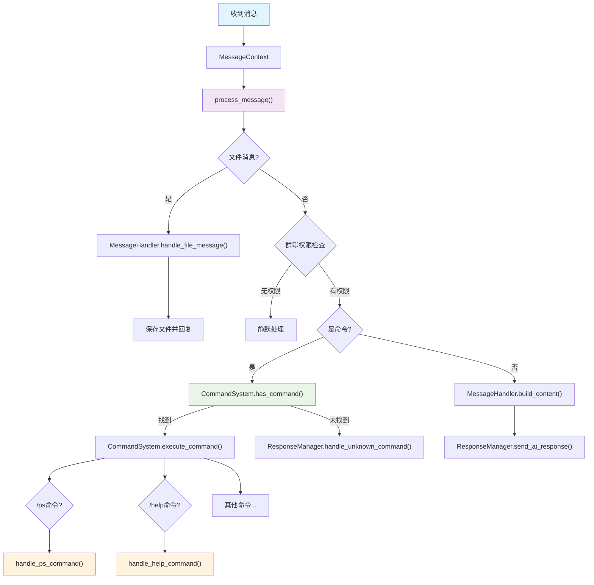
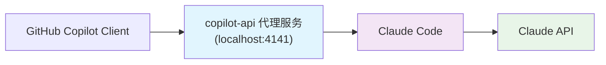

[](https://opensource.org/licenses/MIT)
[](https://github.com)
[](https://github.com)

[🇨🇳 中文文档](./README_CN.md) | [🇺🇸 English](./README.md)

一个全面的 AI 相关实用脚本集合，旨在简化 AI 开发工作流程并自动化常见任务。

## 🤖 WXn8n 微信机器人

### 🚀 功能概述

WXn8n 是一个连接微信和 N8N 工作流的智能机器人，支持：

- 🔗 **N8N 集成** - 无缝连接 N8N 工作流平台
- 💬 **智能对话** - 支持文本消息的 AI 智能回复
- 📁 **文件处理** - 自动处理图片、文档等文件类型
- 👥 **群聊管理** - 支持群聊权限控制和用户管理
- ⚡ **命令系统** - 内置丰富的命令功能（/help、/ps等）
- 🔄 **实时监听** - 实时监听指定用户和群组消息
- 🛡️ **安全认证** - 支持 Webhook 认证和权限控制

### 🖥️ 系统架构



### 💡 主要特性

#### 🔍 智能消息处理

- 自动识别消息类型（文本、图片、文件等）
- 支持群聊和私聊场景
- 智能权限管理和用户白名单

#### 📦 N8N 工作流集成

- **Webhook 触发**: 通过 Webhook 与 N8N 无缝集成
- **文件上传**: 支持向 N8N 发送文件进行处理
- **响应处理**: 自动处理 N8N 返回的结果和文件

#### 🔧 灵活配置管理

- 环境变量配置支持
- 支持测试和生产环境切换
- 可配置监听用户和群组列表
- 自定义超时和认证设置

### 🚀 快速开始

#### 1. 环境准备

```bash
# 进入项目目录
cd AICode/wxn8n

# 安装依赖（使用 uv 包管理器）
uv sync
```

#### 2. 配置设置

```bash
# 复制配置模板
cp config.env.template config.env

# 编辑配置文件
# 配置 N8N Webhook URL、监听用户列表等
```

#### 3. 运行机器人

```bash
# 激活虚拟环境并运行
uv run python main.py
```

### ⚙️ 配置说明

#### 主要配置参数

```bash
# 基础配置
SAVE_PATH=                    # 文件保存路径
LOG_LEVEL=INFO               # 日志级别
LISTEN_INTERVAL=1            # 监听间隔时间

# N8N 集成配置
WEBHOOK_TEST_URL=            # 测试环境 Webhook URL
WEBHOOK_PROD_URL=            # 生产环境 Webhook URL
AUTH_HEADER_KEY=             # 认证头键名
AUTH_HEADER_VALUE=           # 认证头值

# 监听配置
LISTEN_USERS=                # 监听用户列表（逗号分隔）
LISTEN_GROUPS=               # 监听群组列表（逗号分隔）
GROUP_PLUS_USERS=            # 群组特权用户列表

# 超时设置
REQUEST_TIMEOUT=300          # 请求超时时间
IMG_DOWNLOAD_TIMEOUT=30      # 图片下载超时时间
```

### 📋 系统要求

- **Python**: 3.12+
- **依赖**: wxauto>=39.1.15
- **系统**: Windows（微信PC版）
- **N8N**: 已配置的 N8N 工作流实例

## 🔧 Claude Code 自动化部署工具

### 🚀 功能概述

这是一个用于自动化部署 Claude Code 和 Claude Code Proxy 的工具集，支持：

- ✅ **自动安装依赖** - 检测并安装 uv、npm、Claude Code
- 🔄 **代理服务管理** - 自动安装、配置 Claude Code Proxy
- 🚀 **一键启动** - 配置环境变量并启动服务
- ⚡ **端口冲突处理** - 智能检测和解决端口占用问题
- 🔧 **配置管理** - 自动配置 .env 文件和环境变量
- 🌐 **跨平台支持** - 支持 Windows、macOS、Linux

### 🖥️ 系统支持

| 系统 | 脚本文件 | 说明 |
|-----|---------|------|
| 🐧 **Linux/macOS** | `Claude_code_proxy.sh` | 适用于 Unix 系统的 Bash 脚本 |
| 🪟 **Windows** | `Claude_code_proxy.ps1` | 适用于 PowerShell 的脚本 |

## 🔌 Copilot-API 代理服务

### 🚀 功能概述

copilot-api 是一个代理服务，用于将 GitHub Copilot 的 API 调用转发到 Claude Code，支持：

- 🔄 **API 代理转发** - 将 GitHub Copilot API 调用无缝转发到 Claude Code
- 🔑 **GitHub 认证** - 支持 GitHub 设备授权流程
- 🎯 **模型映射** - 自动映射 GitHub Copilot 模型到对应的 Claude 模型
- ⚡ **本地部署** - 在本地运行代理服务，保护隐私
- 🛠️ **简单配置** - 一键安装和配置，快速上手
- 🌐 **兼容性强** - 完全兼容 GitHub Copilot API 接口

### 💡 工作原理



### 🛠️ 安装配置

#### 1. 安装依赖

确保系统已安装 Node.js，然后安装必要工具：

```bash
# 安装 copilot-api
npm install -g copilot-api

# 安装 Claude Code
npm install -g @anthropic-ai/claude-code
```

#### 2. 启动代理服务

打开第一个终端，启动代理服务：

```bash
copilot-api start
```

系统会提示进行 GitHub 授权，按提示访问页面输入设备码完成授权。

#### 3. 配置 Claude Code

在 `~/.claude/settings.json` 中添加配置：

```json
{
  "env": {
    "ANTHROPIC_BASE_URL": "http://localhost:4141",
    "ANTHROPIC_AUTH_TOKEN": "dummy",
    "ANTHROPIC_MODEL": "claude-sonnet-4",
    "ANTHROPIC_SMALL_FAST_MODEL": "claude-3.7-sonnet",
    "DISABLE_NON_ESSENTIAL_MODEL_CALLS": "1",
    "CLAUDE_CODE_DISABLE_NONESSENTIAL_TRAFFIC": "1"
  }
}
```

#### 4. 启动 Claude Code

在第二个终端执行：

```bash
claude
```

### 📋 系统要求

- **Node.js**: 16.0+
- **GitHub 账号**: 需要 GitHub Copilot 访问权限
- **网络连接**: 稳定的互联网连接用于认证

## 🚀 快速开始

### 1. 克隆项目

```bash
git clone https://github.com/sylearn/AICode.git
cd AICode/Claude_Code
```

### 2. 运行脚本

#### Linux/macOS 系统

```bash
# 给脚本执行权限
chmod +x Claude_code_proxy.sh

# 运行脚本
./Claude_code_proxy.sh
```

#### Windows 系统

```powershell
# 以管理员身份运行 PowerShell
Set-ExecutionPolicy -ExecutionPolicy RemoteSigned -Scope CurrentUser

# 运行脚本
.\Claude_code_proxy.ps1
```

### 3. 按照提示完成配置

脚本会自动检测环境并引导您完成配置过程。

## 💡 功能特性

### 🔍 自动环境检测

- 检测 Node.js 和 npm 是否安装
- 检测 Python 包管理器 uv 是否安装
- 检测 Claude Code 是否已安装
- 检测 Git 是否可用

### 📦 自动依赖安装

- **uv 安装**: 自动从官方源安装 Python 包管理器
- **Claude Code 安装**: 通过 npm 全局安装 Claude Code
- **代理服务安装**: 自动克隆和配置 Claude Code Proxy

### 🔧 智能配置管理

- 自动生成和更新 `.env` 配置文件
- 智能检测本地 IP 地址
- 自动配置代理服务器参数
- 支持自定义模型和 API 配置

### ⚡ 端口冲突处理

- 自动检测端口占用情况
- 智能识别和终止冲突进程
- 支持用户交互式选择处理方式

## 📋 系统要求

### 基础要求

- **操作系统**: Windows 10+, macOS 10.14+, Linux (Ubuntu 18.04+)
- **网络**: 稳定的互联网连接
- **权限**: 管理员权限（用于安装依赖）

### 依赖软件

| 软件 | 版本要求 | 自动安装 | 说明 |
|------|----------|----------|------|
| Node.js | 16.0+ | ❌ | 需要手动安装 |
| npm | 8.0+ | ✅ | 随 Node.js 安装 |
| Git | 2.0+ | ❌ | 需要手动安装 |
| uv | 最新版 | ✅ | 脚本自动安装 |
| Claude Code | 最新版 | ✅ | 脚本自动安装 |

## 🛠️ 详细使用说明

### 第一次使用

1. **环境准备**
   - 确保已安装 Node.js 和 Git
   - 准备好您的 OpenAI API Key
   - 准备好您的 API Base URL

2. **运行脚本**
   - 下载并运行对应系统的脚本
   - 脚本会自动检测环境并安装缺失的依赖

3. **配置参数**
   - 脚本会提示您输入 API 配置信息
   - 或者直接修改脚本顶部的配置变量

### 后续使用

如果已经完成初始化，直接运行脚本即可启动服务：

```bash
# Linux/macOS
./Claude_code_proxy.sh

# Windows
.\Claude_code_proxy.ps1
```

### 停止服务

按 `Ctrl+C` 停止 Claude Code 客户端，代理服务会自动停止。

## ⚙️ 配置说明

### 主要配置参数

#### 基础配置

```bash
# 脚本配置区域 (在脚本文件顶部)
CLAUDE_COMMAND="claude"                    # Claude Code 命令名
CLAUDE_DIR="$HOME/.claude"                 # Claude Code 配置目录
PROXY_PORT=8082                           # 代理服务端口
```

#### API 配置

```bash
# API 相关配置
OPENAI_API_KEY="your-api-key-here"        # 您的 OpenAI API Key
OPENAI_BASE_URL="https://api.openai.com/v1" # API Base URL
BIG_MODEL="claude-sonnet-4"               # 大模型名称
SMALL_MODEL="gpt-4o-mini"                 # 小模型名称
```

#### 代理配置

```bash
# 代理服务配置
HOST="0.0.0.0"                           # 服务监听地址
MAX_TOKENS_LIMIT=32000                    # 最大 Token 限制（< 32000）
REQUEST_TIMEOUT=90                        # 请求超时时间
MAX_RETRIES=3                            # 最大重试次数
```

### 环境变量

脚本会自动设置以下环境变量：

- `CLAUDE_CODE_MAX_OUTPUT_TOKENS`: 最大输出 Token 数
- `ANTHROPIC_BASE_URL`: 代理服务地址
- `ANTHROPIC_AUTH_TOKEN`: 代理认证 Token

## 🔧 故障排除

### 常见问题

#### 1. 权限问题

**问题**: 安装依赖时提示权限不足

**解决方案**:
```bash
# Linux/macOS
sudo ./Claude_code_proxy.sh

# Windows (以管理员身份运行 PowerShell)
Set-ExecutionPolicy -ExecutionPolicy RemoteSigned -Scope CurrentUser
```

#### 2. API Error
**问题**:API Error (401 Invalid API key)
```log
[L] API Error (401 {"detail":"Invalid API key. Please provide a valid Anthropic API key."}) Retrying in 1 second
...
2025-07-14 16:03:56,450 - WARNING - Invalid API key provided by client
```

**解决方案**:
```bash
# 检查您的 .env 文件
cat ~/.claude/proxy/claude-code-proxy/.env
```
注释掉ANTHROPIC_API_KEY="your-expected-anthropic-api-key"
或手动去 ～/.claude\proxy\claude-code-proxy 目录下注释掉.env文件中的ANTHROPIC_API_KEY="your-expected-anthropic-api-key"


### 调试模式

如需调试，可以修改脚本中的日志级别：

```bash
LOG_LEVEL="DEBUG"  # 将日志级别改为 DEBUG
```

### 手动清理

如果需要完全重新安装：

```bash
# 清理 Claude Code Proxy
rm -rf ~/.claude/proxy

# 重新安装 Claude Code
npm uninstall -g @anthropic-ai/claude-code
npm install -g @anthropic-ai/claude-code
```

## 📁 项目结构

```text
AICode/
├── Claude_Code/
│   ├── Claude_code_proxy.sh      # Linux/macOS 脚本
│   ├── Claude_code_proxy.ps1     # Windows 脚本
│   └── copilot_api.md            # Copilot-API 代理服务配置教程
├── wxn8n/                        # WXn8n 微信机器人
│   ├── assets/                   # 资源文件
│   ├── config.env.template       # 配置文件模板
│   ├── config.py                 # 配置管理
│   ├── connect_n8n.py           # N8N 连接模块
│   ├── main.py                  # 主程序入口
│   ├── wechat_msg.py            # 微信消息处理
│   ├── pyproject.toml           # Python 项目配置
│   ├── uv.lock                  # 依赖锁定文件
│   └── README.md                # 项目说明文档
├── README.md                     # 英文文档
├── README_CN.md                  # 中文文档
├── License                       # MIT 许可证
└── .gitignore                    # Git 忽略文件
```

## 🤝 贡献指南

我们欢迎您的贡献！请遵循以下步骤：

1. Fork 本仓库
2. 创建您的特性分支 (`git checkout -b feature/AmazingFeature`)
3. 提交您的修改 (`git commit -m 'Add some AmazingFeature'`)
4. 推送到分支 (`git push origin feature/AmazingFeature`)
5. 打开一个 Pull Request

## ⭐ Star 历史

[](https://star-history.com/#sylearn/AICode&Date)

---

**感谢您的支持！🙏**
